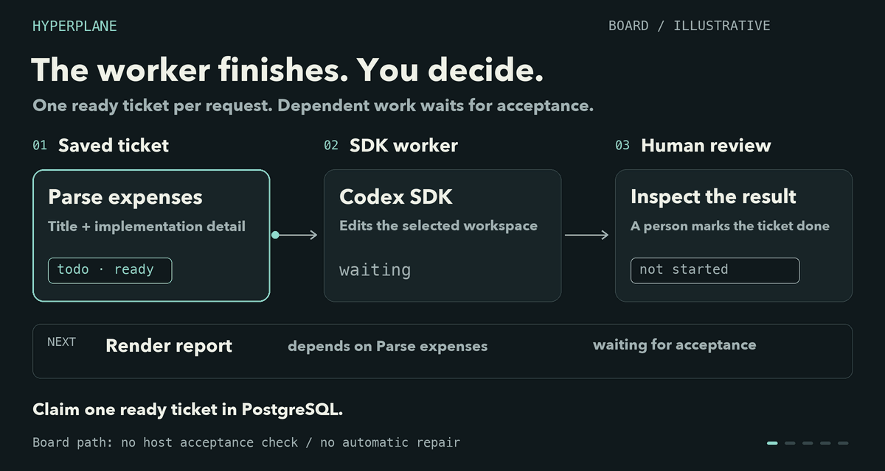

# Hyperplane

Hyperplane runs coding agents against tickets in a local project. On the Board,
a worker takes one ticket and returns its changes for review. You decide when
dependent work can start. For repeatable jobs, the workflow editor lets you
specify inputs, acceptance checks and approval steps.

Go API · React UI · PostgreSQL · Codex SDK

[Start locally](#start-locally) · [Run the checked example](#four-rows-one-checkable-result) · [Read the architecture](DESIGN.md)

<picture>
  <source media="(prefers-reduced-motion: reduce)" srcset="docs/media/board-flow.png">
  
</picture>

In this example, the worker finishes **Parse expenses** and the ticket moves to review.
An engineer accepts it, then makes a separate request to start **Render report**.
[Static diagram](docs/media/board-flow.png) · [Animation source](docs/media/render-board.py)

## How a ticket reaches review

Suppose **Render report** depends on **Parse expenses**. Selecting **Run next task**
claims one eligible ticket in the lane. In one transaction, PostgreSQL saves the ticket claim,
run and initial checkpoint before a worker starts. The Codex SDK receives that
ticket's title, implementation detail and selected workspace.

| What happens | Saved Board state | What can happen next |
|---|---|---|
| Worker finishes successfully | Run `passed`; ticket `review` | A person inspects the result |
| Worker fails or is interrupted | Ticket `blocked` | A person decides how to proceed |
| Person accepts the result | Ticket `done` | Its dependents can become ready |
| Another work request arrives | One ready ticket is claimed | That ticket runs |

Use **Open run** to inspect the result, then mark the ticket **Done** to accept it.
On the Board, the engineer checks the work. The worker has no independent
acceptance check or automatic repair. A later **Run next task** request can
claim a newly eligible ticket.

The SDK owns the model conversation and tools. Hyperplane owns admission,
workspace selection, persistence and the decision that releases a dependency.
[Admission transaction](internal/store/sdk_ticket.go) · [Worker handoff](internal/sdkruntime/ticket.go) · [Behavior tests](internal/httpapi/sdk_board_test.go)

## Choose the boundary your work needs

| Entry point | Work you give it | Completion boundary |
|---|---|---|
| **Board** | Saved tickets with dependencies in a project workspace | Successful runs wait for human review |
| **Workflow** | Reusable steps, inputs and declared dependencies | Configured checks and approval steps govern progress |
| **Project task** | One change in an existing folder | Optional trusted host check; optional single correction |

In **Workflows → Build with steps**, add steps visually or describe one per line.
Choose document, research, model review, human approval or file-producing work.
Review the definition before saving or running it; saving starts no work.

Steps run in order by default. **Start after** defines explicit dependencies,
allowing up to two ready document, research or check steps to run together. Tasks
and approvals run exclusively. Model review and a host-run acceptance program
are different kinds of evidence. See [workflow execution](docs/runtime.md#sdk-workflows-built-from-nodes).

For repeated jobs, declare inputs and reference them as `{slot:id}` in
instructions. Supply values in the UI or with
`bin/hyperplane workflow run <name> --input k=v`. Missing required inputs are
rejected before launch. [Templates and recurring workflows](docs/workflows/README.md)

## Start locally

You need **Go 1.26**, **Node 22+**, **Docker with Compose**, and Codex authentication.
Run from the repository root:

```sh
make setup       # start PostgreSQL, install dependencies, build API + web + CLI
make up          # start the local server
```

Open [the local web app](http://127.0.0.1:4252) in your browser.
The API and Codex run natively on Linux or macOS; Docker runs PostgreSQL.
If this machine has no Codex login, after setup run:

```sh
node packages/agents/node_modules/@openai/codex/bin/codex.js login
```

Ctrl-C stops the API. `make down` stops PostgreSQL and retains its volume.
`make seed` refreshes the optional templates and catalogs.
[Configuration and runtime details](docs/runtime.md#setup-and-configuration)

## Four rows, one checkable result

The bundled example makes the acceptance boundary small enough to read in full.
A worker reads four synthetic expenses and writes `build/totals.csv`. A fixed
Node program, run by the host, checks the output and confirms that the input is
unchanged. A later document step explains the checked result.

```text
input.csv                         build/totals.csv
──────────────────                ──────────────────
category,amount                   category,total
food,10.20                        food,15.00
food,4.80                         travel,6.00
travel,7.25
travel,-1.25
```

After `make sdk-install` and Codex authentication:

```sh
demo_root="$(mktemp -d)"
node examples/sdk-checked-work/workflow.mjs "$demo_root/expenses"
```

This makes actual model calls. The example creates a new output folder and allows
one correction after a normal failing check. The worker can write its `build/`
folder; the input, reference data and check stay outside that writable folder.
The run writes the totals, a `build.md` record with hashes, an `explain.md`
summary and a `receipt.json` result.

The check establishes **these two exact totals and unchanged input**. It does
not establish general CSV-parser or data-pipeline correctness. Read the
[workflow](examples/sdk-checked-work/workflow.mjs),
[acceptance program](examples/sdk-checked-work/acceptance.mjs) and
[example instructions](examples/sdk-checked-work/README.md).

## Bring your own project and check

Choose **Project task**, describe a change and select an existing folder, or use
the CLI. Supply a trusted acceptance program when you need a host-run check:

```sh
bin/hyperplane task --target /absolute/project \
  --check '["node","/absolute/checks/acceptance.mjs"]' \
  --auto-repair --json "Fix keyboard activation"
```

`--auto-repair` permits one correction in the same conversation after a normal
failing check. Without `--check`, the result records that independent verification
was not requested. Acceptance commands run with **host privileges**: keep their
programs and dependencies outside the editable folder when the worker must not
change them. Targets must be separate from Hyperplane's code and run records.
[Project-task rules](docs/runtime.md#direct-sdk-project-tasks) · [Check execution](packages/agents/src/workflows/task.mjs)

The [SDK package](packages/agents/README.md) can also be used directly, with an
ordinary Codex SDK thread and application-owned verification and persistence.

## Verify and inspect

```sh
make sdk-install sdk-test   # SDK adapter tests
make test-unit              # Go tests without database connections
make test-db                # separate disposable PostgreSQL at port 15497
make gate                   # SDK tests, formatting, vet, build, Go tests, UI lint
make web-build web-unit     # frontend build + unit tests
```

Database tests use `TEST_DATABASE_URL`, create separate databases and remove
only those databases afterward. They do not use the application database.
Deterministic tests include fixture model responses; the checked-file example
above exercises the configured model. [Verification guide](docs/evidence/README.md)

| Source | Responsibility |
|---|---|
| [SDK package](packages/agents) | Model execution, tools, optional verification |
| [Run lifecycle](internal/sdkruntime) / [worker transport](internal/codex) | Workspace admission and worker ownership |
| [Workflow definitions](internal/sdkworkflow) / [planning](internal/sdkplanning) | Validation and reviewed proposals |
| [Store](internal/store) | Ticket claims, approvals, checkpoints and migrations |
| [Web](apps/web) / [API](apps/api) / [CLI](apps/cli) | Interfaces to the same saved state |

Automatic crash recovery and general external-app actions are not implemented.
Some data templates still require built-in file contracts and checks. Workspace
locks coordinate Hyperplane writers; other host processes can still edit files.
See the [runtime boundaries](docs/runtime.md) and [remaining work](docs/sdk-migration.md).
